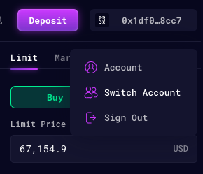
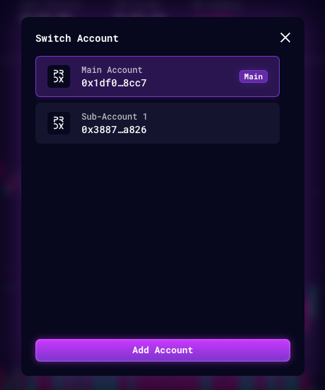
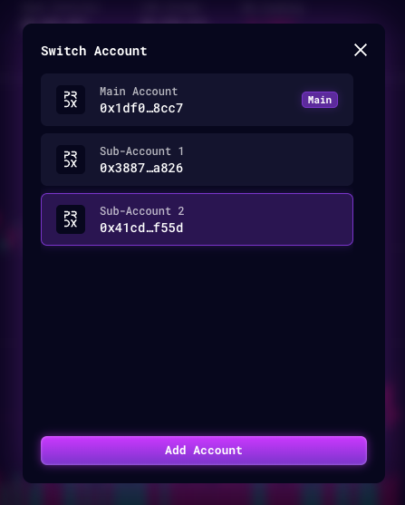

Users could create a Sub-Accounts with a separate L2 Wallet Address that linked to a main account. The sub-account has all the same functionality as a main account.

## Why use a Sub-Account?

Users could create a Sub-Account to trade on a separate account so that:

* Positions could be managed separately
* Margin is shielded from the main account and other accounts
* Liquidation will not affect the collateral kept in other accounts.

## How to create a sub-account

<Note>
Your main account must be deployed before you can create a sub-account. A new account is deployed by its first deposit, so fund the main account first. Via the API, creating a sub-account or isolated market account under a main account that is not yet deployed fails with `400 INVALID_PARENT_ACCOUNT`. See [Account deployment](/docs/accounts/wallet-integration#account-deployment).
</Note>

**Step 1:** Under the 'Account' button on the top right corner, click on 'Switch Account'.

**Step 2:** On the 'Switch Account' pop-up, click on 'Add Account'.

**Step 3:** Click on the newly created Sub-Account to enter it.

