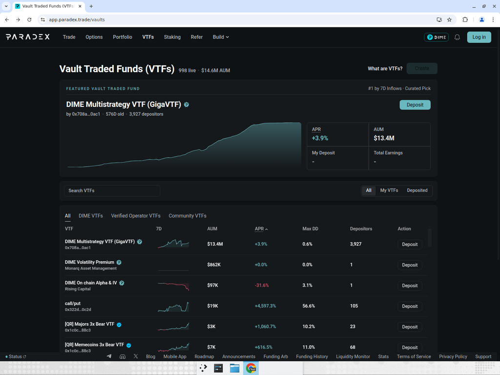
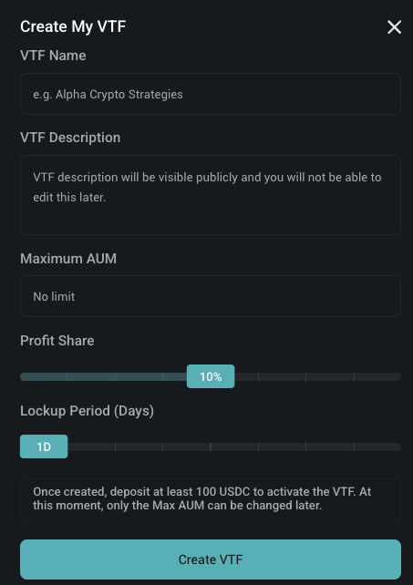

<Note>
The account that creates a VTF must be deployed. A new Paradex account is deployed by its first deposit, so fund it before creating a VTF. Until then, creation fails with `400 INVALID_PARENT_ACCOUNT`. See [Account deployment](/docs/accounts/wallet-integration#account-deployment).
</Note>

<Steps>
  ### Create
    Go to [https://app.paradex.trade/vaults](https://app.paradex.trade/vaults), click on the "Create" button on the top right hand corner.
    
  ### Enter Details
    Enter the details to create your VTF.
    
  ### Initial Deposit
    Follow the steps in [deposit](vault-deposit "mention") to activate your VTF with a first deposit.
</Steps>
